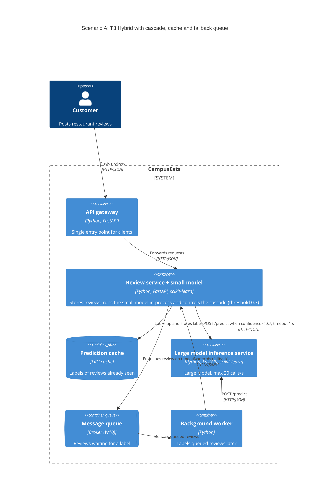

# Task 4: Deployment topologies and trade-offs

**Name / ชื่อ:** Putthitorn Chalitchaiya

**Student ID / รหัสนิสิต:** 6870197421

This is **individual work**: each student completes and submits their own copy, in their own fork.

*งานนี้เป็น**งานเดี่ยว** นิสิตแต่ละคนทำและส่งงานของตัวเอง ใน fork ของตัวเอง*

**Scenario (A, B or C) / Scenario ที่เลือก:** A (Owner alerts)

เลือก A เพราะเป็น alert แบบ real-time ที่ต้องคุมทั้งความเร็ว ความแม่น และจำนวน call ไป large model ซึ่ง cascade ช่วยลดได้

Choose **one** scenario below. If the last digit of your student ID is odd, take A or B; if it is even, take B or C. Use your measurements from Tutorial 6 as evidence: cite run names from `results/runs.csv`. Answer in Thai or English.

เลือก scenario **หนึ่ง** ข้อด้านล่าง ถ้าเลขตัวสุดท้ายของรหัสนิสิตเป็นเลขคี่ ให้เลือก A หรือ B ถ้าเป็นเลขคู่ ให้เลือก B หรือ C ใช้ผลการวัดจาก tutorial ที่ทำไปเป็นข้อมูลอ้างอิง โดยอ้างชื่อ run จาก `results/runs.csv` จะตอบเป็นภาษาไทยหรือภาษาอังกฤษก็ได้

Facts that hold in every scenario / ข้อเท็จจริงที่ใช้กับทุก scenario:

- The large model serves at most **20 calls per second** (4 calls at once × about 200 ms each), and every call costs money.

  *large model รับได้สูงสุด **20 calls ต่อวินาที** (พร้อมกัน 4 calls × ประมาณ 200 ms ต่อ call) และทุก call มีค่าใช้จ่าย*
- The small model is fast and cheap enough to run anywhere, including inside the review service or on a kiosk, but it is much less accurate on its own.

  *small model เร็วและถูกพอที่จะรันที่ไหนก็ได้ รวมถึงภายใน review service หรือบน kiosk แต่ถ้าใช้ตัวเดียวจะแม่นน้อยกว่ามาก*

## Scenarios

**A. Owner alerts.** When a customer posts a negative review, the restaurant owner gets a push notification within **2 seconds**. At the lunch peak, CampusEats receives **40 reviews per second**. A missed alert is acceptable, but a wrong alert (for example, "your customer is unhappy" when they are happy) makes owners stop trusting alerts and, in the end, ignore them.

*เมื่อลูกค้าโพสต์รีวิวเชิงลบ เจ้าของร้านจะต้องได้รับ push notification ภายใน **2 วินาที** เวลาช่วงพีคตอนเที่ยง CampusEats ได้รับรีวิวจำนวน **40 รายการต่อวินาที** การพลาด alert ไปบ้างนั้นยอมรับได้ แต่ alert ที่ผิด (เช่น "ลูกค้าไม่พอใจ" ทั้งที่จริงๆ แล้วพอใจ) จะทำให้เจ้าของร้านไม่เชื่อถือและเลิกสนใจ alert ในที่สุด*

**B. Canteen kiosk.** A tablet in each canteen lets students leave a review on the spot. However, the canteen Wi-Fi is poor: the tablets lose their connection several times a day, for minutes at a time. The system must accept every review, even while a tablet is offline. Restaurant owners need the labels **by the end of the day**.

*มี tablet ในแต่ละโรงอาหารให้นิสิตรีวิวได้ทันที อย่างไรก็ดี การเชื่อมต่อ Wi-Fi ในโรงอาหารไม่ดี ทำให้ tablet หลุดการเชื่อมต่อวันละหลายครั้ง ครั้งละหลายนาที ระบบจะต้องรับรีวิวได้ทุกรายการแม้ขณะที่กำลัง offline อยู่ และเจ้าของร้านต้องการ label **ภายในสิ้นวัน***

**C. Weekly report.** Restaurant owners want a weekly sentiment report. Nothing in producing this report has to be real-time. **Accuracy matters most** and **cost must be minimal**.

*เจ้าของร้านต้องการรายงาน sentiment รายสัปดาห์ ไม่มีอะไรที่จะต้องทำแบบ real-time ในการออกรายงานนี้ ความแม่นยำ **(accuracy) สำคัญที่สุด** และ **ค่าใช้จ่ายต้องน้อยที่สุด***

## Topologies and patterns to choose from / Topology และ pattern ที่เลือกใช้ได้

| | Topology | Where the model runs / โมเดลรันที่ไหน |
|---|---|---|
| T1 | Model as a service, synchronous | Inference service, called for each review (today's baseline) *inference service ถูกเรียกทุกรีวิว (baseline ของวันนี้)* |
| T2 | Model as a library | Inside the review service, or on the device *ภายใน review service หรือบนอุปกรณ์* |
| T3 | Hybrid | Small model locally, large model as a remote service *small model รันในเครื่อง large model เป็น remote service* |
| T4 | Asynchronous / batch | Reviews are queued (broker, W10) or stored, and scored later in bulk *รีวิวถูกเข้าคิว (broker, W10) หรือเก็บไว้ แล้วติด label ทีหลังเป็นชุด* |

Combine one topology with any of the patterns from Tutorial 6: **fallback**, **cascade** and **cache**.

*เลือก topology หนึ่งแบบ แล้วผสมกับ pattern จาก Tutorial 6 ได้ตามต้องการ: **fallback**, **cascade** และ **cache***

## 1. Quality requirements

The three most important quality requirements for your scenario, each with a number where possible.

*quality requirements ที่สำคัญที่สุด 3 ข้อของ scenario ที่เลือก ระบุตัวเลขเมื่อทำได้*

| # | Quality | Requirement |
|---|---|---|
| 1 | Performance | alert ถึงเจ้าของร้านภายใน 2 วินาทีหลังโพสต์รีวิว (ยังต้องทดสอบที่ 40 รีวิว/วินาที) |
| 2 | Capacity / Cost | รับได้ 40 รีวิว/วินาทีช่วงพีค โดยเรียก large model ไม่เกิน 20 calls/s |
| 3 | Accuracy | alert ผิดไม่เกิน 6% ของ alert ทั้งหมด (t3-cache ผิด 6 จาก 107 = 5.6% วัดจากรีวิว 200 รายการ) |

## 2. Design / การออกแบบ

Your topology, the patterns you add, and a container-level diagram (C4 level 2). The C4 diagram must be written in Mermaid.

*topology ที่เลือก pattern ที่เพิ่ม และ diagram ระดับ container (C4 level 2) เขียนด้วย Mermaid*

**Topology:** T3 Hybrid: small model อยู่ใน review service ส่วน large model แยกเป็นอีก service

**Patterns:**
- Cascade: small ตอบก่อน ถ้า confidence ต่ำกว่า 0.7 ค่อยส่งไป large
- Cache: เช็ค cache ก่อนเรียกโมเดล รีวิวที่เคยเจอแล้วไม่ต้องคิดใหม่
- Fallback: ถ้า large ไม่ตอบภายใน 1 วินาที เอารีวิวไปเข้าคิวให้ worker ทำทีหลัง และไม่ส่ง alert จากผลที่ยังไม่ชัวร์

**Containers:**
1. API gateway: รับ request จาก client แล้วส่งต่อให้ review service (HTTP)
2. Review service + small model: เก็บรีวิว รัน small model ในตัว และคุม cascade
3. Cache: เก็บ label ของรีวิวที่เคยเจอ
4. Large model inference service: รัน large model รับ request จาก review service (HTTP)
5. Message queue: เก็บรีวิวที่ยังไม่ได้ label ตอน large ไม่ตอบ
6. Background worker: ดึงรีวิวจากคิวไปถาม large แล้วบันทึก label กลับไปที่ review service

คิวมีไว้เก็บงานที่ค้างเท่านั้น เส้นทางหลักยังเป็น T3 ไม่ได้เปลี่ยนเป็น T4

## 3. Evidence / หลักฐาน

Which runs support your choice? Show the numbers and, for scenario A, the capacity arithmetic: how many large-model calls per second does your design need at the peak?

*run ไหนที่สนับสนุนการตัดสินใจของนิสิต ให้นิสิตแสดงตัวเลขประกอบ และสำหรับ scenario A ให้นิสิตแสดงการคำนวณ capacity ด้วย เพื่อแสดงว่าในช่วงพีคนั้น design ของนิสิตต้องใช้ large model กี่ calls ต่อวินาที*

| Run | What it shows / แสดงอะไร |
|---|---|
| t0-large | accuracy 93.5% alert ผิด 5 แต่ large calls 100% = 40 calls/s เกิน capacity |
| t2-0.6 | accuracy 91.5% large calls 38% แต่ alert ผิด 10 เกือบสองเท่าของ large อย่างเดียว |
| t2-0.7 | accuracy 93.0% alert ผิด 6 แต่ large calls 53% = 21.2 calls/s เกิน capacity |
| t3-cache | threshold 0.7 กับ cache: accuracy 93.0% alert ผิด 6 large calls ลดเหลือ 38% p50 79 ms |

จำนวน alert ผิดไม่มีใน `runs.csv` จึงนับเพิ่มโดยรันสองโมเดลแบบ offline กับรีวิว 200 รายการชุดเดียวกับ load test ซึ่งได้ accuracy ตรงกับ `runs.csv` ทุก run

**Capacity:** 40 × 0.38 = 15.2 calls/s ไม่เกิน 20 calls/s เหลือ 4.8 calls/s (ถ้าสัดส่วน cache hit และ large calls ตอนใช้งานจริงใกล้กับที่วัดได้)

## 4. ADR

Use the ADR format from W5.

*ใช้รูปแบบ ADR จาก W5*

**Title:** ใช้ T3 Hybrid + cascade 0.7 + cache + fallback queue สำหรับ owner alert

**Status:** Proposed

**Context:** ช่วงพีคมี 40 รีวิว/วินาที ต้องส่ง alert ภายใน 2 วินาที แต่ large model รับได้แค่ 20 calls/s และ alert ผิดแย่กว่า alert ที่พลาด เพราะเจ้าของร้านจะเลิกเชื่อ alert

**Decision:** รัน small model ใน review service ส่งไป large ผ่าน HTTP เฉพาะตอน confidence ต่ำกว่า 0.7 ใช้ cache กันการคิดซ้ำ และถ้า large ไม่ตอบให้เอารีวิวเข้าคิวไว้ทำทีหลัง

**Consequences:**
- Positive: accuracy 93.0% alert ผิด 6 จาก 107 (5.6%) น้อยกว่า threshold 0.6 ที่ผิด 10
- Positive: cache ลด large calls จาก 53% เหลือ 38% ใช้ large แค่ 15.2 calls/s ไม่เกิน 20
- Positive: ถ้า large ค้าง request ก็ไม่ค้างตาม
- Negative: ระบบซับซ้อนขึ้น ต้องดูแล cache, queue และ worker เพิ่ม และ small ยังผิดแบบมั่นใจสูงได้จนส่ง alert ผิด
- Negative: p50/p95 วัดที่ 10 request พร้อมกัน ไม่ใช่ 40 รีวิว/วินาที ยังบอกไม่ได้ว่าจะทัน 2 วินาทีตอนพีคจริง ต้อง load test เพิ่ม

**Alternatives considered:** at least one topology you rejected, and why.

*อย่างน้อยหนึ่ง topology ที่ไม่เลือก และเหตุผล*

> - large อย่างเดียว (T1): แม่นสุด (93.5% ผิด 5) แต่ต้องใช้ 40 calls/s เกิน 20
> - cascade 0.6: ใช้ large 38% เท่ากัน แต่ alert ผิด 10 เกือบสองเท่า
> - cascade 0.7 ไม่มี cache: accuracy เท่ากัน แต่ต้องใช้ 21.2 calls/s เกิน capacity
